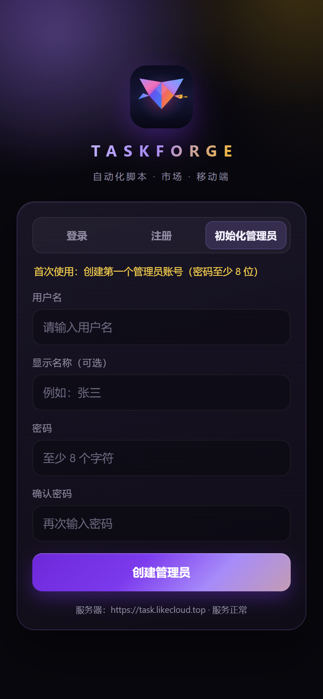

# Marketplace 服务端部署（task.likecloud.top）

生产环境：腾讯云 Ubuntu 24.04（`43.167.208.57`），目录 `/home/ubuntu/taskforge/server`。
对外域名 `https://task.likecloud.top`，由 Cloudflare 代理 + nginx 反代到本机 Node 服务。

## 架构

```
客户端 / 浏览器
   │ HTTPS (Cloudflare 边缘证书, Universal SSL)
   ▼
Cloudflare（代理模式, Full / Full(strict)）
   │ HTTPS 回源, 源站证书 = Cloudflare Origin CA 通配符 *.likecloud.top
   ▼
nginx :443  (taskforge-marketplace.conf)
   │ HTTP 127.0.0.1:8268
   ▼
systemd: taskforge-marketplace  →  node dist/index.js
   ├─ 数据: /home/ubuntu/taskforge/server/data/marketplace.db
   └─ 密钥: /home/ubuntu/taskforge/server/.env (0600)
```

- Node 服务只监听 `127.0.0.1:8268`，公网仅暴露 nginx 的 80/443。
- 80 端口统一 301 跳转 HTTPS。
- Cloudflare 回源 IP 通过 nginx `real_ip` 还原为真实客户端 IP（只信任 Cloudflare 官方网段），
  Express 设置 `trust proxy = 1`，限流按真实 IP 生效。

## 部署文件

| 文件 | 作用 |
|---|---|
| `deploy/server/taskforge-marketplace.service` | systemd 单元（开机自启、崩溃自动重启、安全加固） |
| `deploy/server/nginx-task.likecloud.top.conf` | nginx 站点（HTTPS + 反代 + 上传 60m + HSTS） |
| 服务器 `server/dist` | `server/` 的 TypeScript 构建产物（`npx tsc`） |
| 服务器 `server/package.json` + `package-lock.json` | 运行时依赖清单 |
| 服务器 `server/node_modules` | `npm ci --omit=dev` 安装（约 44MB） |

## 首次部署 / 更新部署

```bash
# 本地：构建并同步产物
cd server && npx tsc
# 通过 DSH 远程同步把 server/dist 推到 /home/ubuntu/taskforge/server/dist，然后：
ssh ubuntu@43.167.208.57
cd /home/ubuntu/taskforge/server
npm ci --omit=dev --no-audit --no-fund   # 依赖有变更时
sudo systemctl restart taskforge-marketplace
curl -s http://127.0.0.1:8268/api/health
```

> 提示：DSH 远程 SFTP 覆盖已有文件曾出现 `Failure`；更新 `dist` 时可先在服务器删除目标文件再同步（或直接通过 `remote_exec` + base64 写入）。

## systemd 运维

```bash
sudo systemctl enable taskforge-marketplace   # 开机自启（已启用）
sudo systemctl start|stop|restart taskforge-marketplace
systemctl status taskforge-marketplace
sudo journalctl -u taskforge-marketplace -f   # 实时日志
```

## nginx 运维

```bash
sudo nginx -t && sudo systemctl reload nginx
sudo tail -f /var/log/nginx/taskforge.access.log /var/log/nginx/taskforge.error.log
```

修改站点文件后先 `nginx -t`，通过再 `reload`。证书路径：

- `/etc/nginx/ssl/likecloud.top.pem`（Cloudflare Origin CA，`*.likecloud.top`，有效期至 2041）
- `/etc/nginx/ssl/likecloud.top.key`

## 健康检查与验证

```bash
# 源站
curl -s http://127.0.0.1:8268/api/health
# 源站 HTTPS（绕过 DNS）
curl -sk --resolve task.likecloud.top:443:127.0.0.1 https://task.likecloud.top/api/health
# 公网（经 Cloudflare）
curl -s https://task.likecloud.top/api/health
# 期望: {"status":"ok","db":"connected","timestamp":"...","needsSetup":true}
```

## 首次初始化（重要）

服务当前 `needsSetup=true`。请在客户端 Settings → Marketplace 服务器地址填入
`https://task.likecloud.top`，然后使用「初始化管理员」创建第一个管理员账号。

> 初始化接口 `/api/auth/setup` 在首个用户创建前对外可用；部署完成后请尽快完成初始化，
> 避免被他人抢先创建管理员。初始化完成后该接口自动失效（403）。

## 安全配置摘要

- Node 绑定 `127.0.0.1`，8268 不对外（实测公网 8268 超时）。
- systemd：`NoNewPrivileges`、`ProtectSystem=full`、`ProtectHome=read-only`、`PrivateTmp`，仅工作目录可写。
- 限流：认证 10/min、通用 API 100/min，按 Cloudflare 还原后的真实客户端 IP 计数（实测第 11 次登录返回 429）。
- HSTS：`max-age=15552000`；隐藏 `X-Powered-By`。
- 上传：nginx `client_max_body_size 60m`，服务端 multer 限制单文件 50MB。
- `.env`（JWT_SECRET / MARKETPLACE_API_KEY）首次启动自动生成，权限 0600。
- legacy 全局 admin key 默认关闭（需 `ALLOW_LEGACY_ADMIN_KEY=1` 才启用）。

## 移动端 PWA（https://task.likecloud.top/app/）

仓库 `mobile/` 是独立的 Vite + React 移动端 PWA，复用同一域名下的 `/api`（同源，无 CORS），
由 nginx 静态托管，可添加到手机主屏幕（iOS Safari：分享 → 添加到主屏幕；Android Chrome：安装应用）。

### 部署/更新

```bash
cd mobile && npm install && npm run build        # 产物 mobile/app/
# 更新时先删除远程旧产物目录（DSH 远程同步对已存在文件覆盖会失败，且 hash 文件名会残留）
ssh ubuntu@43.167.208.57 'rm -rf /home/ubuntu/taskforge/mobile/app'
# 通过 DSH 远程同步推送 mobile/app -> /home/ubuntu/taskforge/mobile/app
# 若远程目录不存在，先 mkdir -p /home/ubuntu/taskforge/mobile/app/{assets,icons}
```

nginx 相关配置见 `deploy/server/nginx-task.likecloud.top.conf`：

- `/app/` → 静态文件（`root /home/ubuntu/taskforge/mobile`，SPA 回退 `/app/index.html`）
- `/app/assets/` → 30 天强缓存；`/app/index.html`、`/app/sw.js` → 不缓存
- `/` → 302 到 `/app/`
- `/api/*` 及其余路径 → `127.0.0.1:8268`

### 验证

```bash
curl -s https://task.likecloud.top/app/ | head -5
curl -sI https://task.likecloud.top/app/manifest.json
curl -sI https://task.likecloud.top/app/sw.js
```

> 注意：nginx 需要能读取部署目录。若放在 `/home/ubuntu` 下，`/home/ubuntu` 需为 `711`
> （允许 www-data 穿越但不列目录）；当前已按此配置。



## Android App（APK 分发）

Android App 构建说明见 [`mobile/README.md`](../mobile/README.md)。APK 由 nginx 静态提供下载：

```nginx
location = /download/TaskForge.apk {
    alias /home/ubuntu/taskforge/mobile/TaskForge.apk;
    default_type application/vnd.android.package-archive;
    add_header Content-Disposition 'attachment; filename="TaskForge-1.0.0.apk"';
    expires -1;
}
```

- 下载地址：<https://task.likecloud.top/download/TaskForge.apk>
- 服务器路径：`/home/ubuntu/taskforge/mobile/TaskForge.apk`（更新 APK 时覆盖该文件即可，无需 reload nginx）
- 当前为 debug 签名（可侧载安装）；上架/长期分发建议配置正式签名
